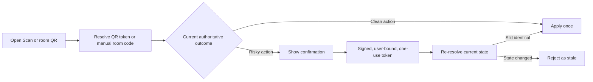

# Faculty User Flow

Status: authoritative implementation contract, audited 2026-07-23.

This document describes the Faculty role as implemented by the live routes,
views, templates, domain services, and automated tests. `docs/USER_FLOWS.md` is
an older cross-role design snapshot and must not be used to infer current
Faculty behavior.

## Role boundary

Every Faculty endpoint requires an authenticated user whose role is `FACULTY`.
Faculty data is owner-scoped: a faculty member cannot operate on another
faculty member's session, modality request, or private profile photo. Checkers
and system superusers may retrieve a Faculty photo for identity verification;
other users may not.

## Entry and navigation

1. The user signs in through Microsoft Entra SSO. Development-only account
   selection follows the same redirect behavior.
2. A same-origin `next` path is preserved through sign-in. This lets a room QR
   deep link return to `/scan?t=...` after authentication. External redirect
   targets are rejected.
3. Faculty lands on `/faculty/home` during ordinary navigation.
4. Persistent Faculty navigation exposes Home, Schedule, Scan, Requests,
   notifications, profile, and sign out.
5. If there is no active academic term, Home and Schedule say so explicitly;
   they do not imply that the user merely has no classes.

## Home and schedule

The Home hero selects the next actionable session in this order:

1. the Faculty user's active session;
2. the Faculty user's scheduled session today;
3. the Faculty user's next scheduled future session.

Cancelled sessions are never selected as the hero. Schedule shows today and a
rolling seven-day window, identifies cancelled sessions, and displays the
cancellation reason when one exists.

Face-to-face and blended sessions direct the user to Scan. Online sessions
direct the user to the online verification/start surface. The hero can prefill
a modality-shift request with the selected schedule and desired target
modality.

## Face-to-face and blended attendance

- Check-in opens at the scheduled start time. Grace and early-end thresholds
  are policy controlled.
- Manual room codes are rate-limited and invalid attempts are audited.
- The resolver considers only the signed-in Faculty user's sessions in the
  active term.
- Wrong-room changes, occupied-room handovers, and early endings require a
  confirmation step.
- Confirmation tokens are signed, expire, belong to one user, contain a random
  one-use nonce, and are rejected if the underlying session/room state changed.
- Early ending requires a non-blank reason, enforced server-side.
- Force handover locks and revalidates the current room occupant before making
  changes.
- Repeating an immediate resolved scan does not reapply its side effects.
- Check-in and checkout propagate atomically across eligible merged sessions.
  Early-end status and reason propagate with checkout.
- A room manually released by IFO does not count as occupied, even if its
  session remains active for attendance history.

When the user cannot check in because the schedule is missing or incorrect,
the recovery path is to contact IFO. Faculty cannot invent or backfill their
own official schedule.

## Online attendance

Online verification and online attendance state are distinct:

1. Faculty opens `/faculty/online`.
2. A scheduled, effectively-online session can be verified and started only by
   its owner in the active term.
3. Starting records the session as active and creates an audit event.
4. An active online session exposes Checkout.
5. Checkout completes the session and merged siblings atomically.
6. Checkout before the early-end threshold requires a reason and records the
   early-end state; normal checkout does not.
7. Completed, cancelled, absent, foreign, or inactive-term sessions cannot be
   started or checked out through these endpoints.

## Modality-shift requests

Faculty may request a future session or group of sessions to move modality,
room, or time. Faculty does not directly change the authoritative schedule.

- A Home link can preselect the owned schedule and target modality.
- Faculty must explain why the change is needed and how the class will
  continue for students; this rationale is shown to the Dean.
- Review shows the exact currently materialized occurrences, requested
  modality, rationale, optional time, and room preferences before submission.
- End time must be later than start time. This is enforced in both the web
  handler and domain service.
- One requested time applies to one class only. Classes needing different time
  changes require separate requests.
- Online requests ignore room and time controls, including stale hidden values.
- The request is routed to the Dean and starts as pending.
- My Requests shows affected classes, rationale, requested time, preferred and
  assigned rooms, request status, decision reason, and decision metadata.
- Only the requester can withdraw their own pending request, after confirming.
- Approval or rejection occurs in the Dean flow.
- Approval requires confirmation, revalidates current sessions and rooms, and
  denies a request when no actionable sessions remain.
- Out-of-service rooms are never offered or assigned.

## History, profile, and notifications

- History is restricted to the signed-in Faculty user's sessions.
- Profile-photo upload normalizes the image and reports status through an
  accessible live region.
- Profile photos are served by an authenticated application endpoint, not a
  public `/media/profile_photos/` URL. Production nginx explicitly refuses
  direct access to that directory.
- Notifications link the user back to the relevant Faculty surface.

## Route contract

| Purpose | Route |
|---|---|
| Home | `/faculty/home` |
| Schedule | `/faculty/schedule` |
| Scan screen | `/scan` |
| Resolve scan | `/scan/resolve` |
| Confirm scan | `/scan/confirm` |
| Online sessions | `/faculty/online` |
| Start online session | `/faculty/online/<session>/start` |
| Checkout online session | `/faculty/online/<session>/checkout` |
| Attendance history | `/faculty/history` |
| New modality request | `/faculty/modality/new` |
| My modality requests | `/faculty/modality/mine` |
| Withdraw pending request | `/faculty/modality/<request>/withdraw` |
| Profile | `/faculty/profile` |
| Protected Faculty photo | `/faculty/photo/<user>` |

## Regression coverage

The Faculty contract is covered by the scheduling, scan, online, merged-session,
profile, modality, journey, verification, and deployment test modules. Security
regressions include non-Faculty access, cross-Faculty object access, stale and
replayed confirmations, invalid state transitions, unsafe login redirects, and
public profile-photo exposure.
